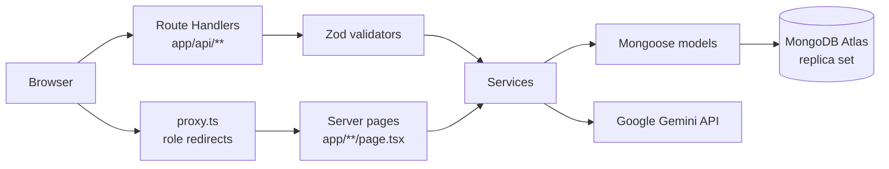
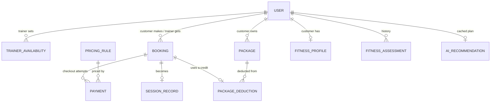

# Architecture

This document covers how Zuryo is organized and how its main workflows work. For what is and isn't built, see [feature-status.md](feature-status.md).

## System overview

Zuryo is a single Next.js app deployed on Vercel. Pages and JSON APIs live in the same codebase. Every API request goes through the same layers:

1. **Route Handler** (`app/api/**/route.ts`): reads the session and checks the user's role.
2. **Validator** (`validators/`): checks the input with Zod.
3. **Service** (`services/`): runs the business rules.
4. **Model** (`models/`): reads and writes MongoDB through Mongoose.

Server-rendered pages call the same services directly instead of going through HTTP.

- **Gemini** is called only from server code (`services/ai/gemini.ts`), and only when a customer views or regenerates a workout plan.
- **No other external services** are used. There is no payment gateway, email or SMS provider, queue or cache server.

## Tech stack and rationale

| Choice | Why it fits this MVP |
| --- | --- |
| Next.js App Router | One deployable app for the UI and the API. Server components keep data fetching on the server, and Vercel hosting needs no setup. |
| MongoDB + Mongoose | Flexible documents for profiles and workout records. Atlas provides the replica set needed for multi-document transactions, which the booking and payment rules rely on. |
| Zod | One schema validates both the forms and the APIs, so client and server rules can't drift apart. |
| JWT cookie (`jose`) | Stateless sessions, with no session store to run. |
| Gemini Flash-Lite | Has a free tier, low cost and fast responses, and supports a JSON response schema. |
| Bun | Fast installs, script runner and built-in test runner. |

## Database schema

MongoDB holds 11 collections, each defined as a Mongoose model in `models/`. All of them get `createdAt` and `updatedAt` automatically. Times are stored in UTC and shown in IST, and money is stored as whole paise (₹1 = 100 paise), so there's no rounding drift.

| Collection | Key fields | Important indexes |
| --- | --- | --- |
| **User** | `name`, `email`, `passwordHash` (never returned), `role` (customer, trainer or admin), `isActive`, `specialties`, `scheduleVersion` (used as the per-trainer lock) | unique `email` |
| **TrainerAvailability** | `trainerId`, `date`, `startTime`, `endTime`, `serviceZone`, `isAvailable` | `{trainerId, startTime, endTime}`, `{serviceZone, date, isAvailable}` |
| **Booking** | `customerId`, `trainerId`, `startTime`, `endTime`, `bookingType` (instant or scheduled), `serviceZone`, `status`, `paymentStatus`, `sessionPrice` / `commissionAmount` / `totalAmount` (filled in once paid), `idempotencyKey` | `{trainerId, startTime, endTime}` for overlap checks, unique `{customerId, idempotencyKey}` |
| **Payment** | `bookingId`, `customerId`, `status` (pending, paid, failed or expired), the price snapshot (`isPeak`, `sessionPrice`, `commissionPercent`, `commissionAmount`, `totalAmount`), `pricingRuleId`, `expiresAt`, `paidAt`, `failureReason` | partial unique: one `paid` payment and one `pending` payment per booking |
| **PricingRule** | `name`, `normalPrice`, `peakPrice`, `commissionPercent`, `peakSlots[]` (days of the week plus start and end time), `isActive` | partial unique: only one active rule |
| **SessionRecord** | `bookingId`, `customerId`, `trainerId`, `status` (in progress or completed), `startedAt`, `endsAt`, `completedAt`, `exercises[]`, `trainerNotes`, `suggestedNextWorkout`, `customerFeedback {rating, comment}` | unique `bookingId` (one session per booking) |
| **FitnessProfile** | `customerId`, `age`, `weight`, `fitnessGoals[]`, `experienceLevel`, `workoutPreferences` | unique `customerId` |
| **FitnessAssessment** | the same fitness fields, saved as a new dated row each time the profile changes | `{customerId, createdAt}` |
| **Package** | `customerId`, `totalSessions`, `usedSessions`, `remainingSessions`, `status` (active, exhausted, expired or cancelled), `source` (seed or admin) | `{customerId, status}` |
| **PackageDeduction** | `bookingId`, `sessionRecordId`, `customerId`, `packageId`, `outcome` (deducted or no_package) | unique `bookingId`, so a session is never charged twice |
| **AiRecommendation** | `customerId`, `recommendation` (the plan JSON), `inputHash`, `model`, `promptVersion`, `generatedAt`, `regenerations[]` | unique `customerId` (one cached plan each) |

Booking status (pending, confirmed, completed or cancelled) and payment status (unpaid, paid or failed; `refunded` exists in the enum but nothing sets it yet) are separate fields on purpose: paying never changes the booking's lifecycle status. The session statuses shown in the UI (scheduled, in progress, completed, missed) are worked out from the booking and its session record.

## Important API routes

All responses are JSON, and errors look like `{ error, fieldErrors? }`.

| Area | Routes |
| --- | --- |
| Auth | `POST /api/auth/register`, `POST /api/auth/login`, `POST /api/auth/logout`, `POST /api/auth/demo`, `GET /api/auth/me` |
| Availability | `GET /api/availability` (customer slot search); `GET`/`POST /api/trainers/me/availability`; `PATCH`/`DELETE /api/trainers/me/availability/[id]` |
| Booking | `POST /api/bookings`, `GET /api/bookings/me`, `GET /api/bookings/[id]` |
| Checkout | `GET /api/bookings/[id]/quote`, `POST /api/bookings/[id]/checkout`, `POST /api/payments/simulate` |
| Sessions | `GET /api/sessions/me`; `POST /api/sessions/[id]/start` and `/complete`; `PATCH /api/sessions/[id]/record`; `PUT /api/sessions/[id]/feedback` |
| Customer data | `GET`/`PUT /api/fitness-profile/me`, `GET /api/progress/me`, `GET /api/packages/me`, `GET /api/sessions/history/me` |
| AI | `GET /api/recommendations/me`, `POST /api/recommendations/me/regenerate` |
| Admin | `GET`/`PUT /api/admin/pricing`, `GET`/`POST /api/admin/packages`, `GET /api/admin/bookings`, `GET /api/admin/bookings/[id]`, `GET /api/admin/users` |
| Health | `GET /api/health` (pings the database) |

## Core business workflows

### Booking creation and trainer assignment
`createBooking` in `services/booking.service.ts` handles every new booking:

1. It checks the start time. Instant sessions start within the next 60 minutes; scheduled ones start between 60 minutes and 30 days ahead. Every start falls on a 15-minute mark, and every session lasts 60 minutes, with the end time set by the server.
2. A trainer is **eligible** when all of these hold:
   - the account is active
   - one of their availability windows in the requested zone covers the whole session
   - they have no overlapping booking that is `pending` or `confirmed`
3. If the customer picked a preferred trainer, only that trainer is tried. If they're unavailable, the request fails with `409` and is never handed to someone else.
4. Otherwise eligible trainers are tried in ascending `_id` order, so the result is deterministic.

### Double-booking prevention
- **Per-trainer lock:** a check-then-insert can race. So each booking runs in a MongoDB transaction that first increments the trainer's `scheduleVersion` (`services/schedule-lock.ts`). Two concurrent transactions for the same trainer then conflict on that write, and MongoDB aborts one with a write conflict. The retried transaction sees the committed booking and fails the overlap check. Availability edits go through the same lock.
- **Duplicate submissions:** a client-generated `idempotencyKey`, backed by a unique index on `{customerId, idempotencyKey}`, makes a repeated submission return the original booking.

### Pricing and simulated checkout
- **Price:** the session costs the normal or peak price, plus a commission rounded half-up to whole paise (`calculateQuote` in `lib/pricing.ts`). Peak windows are evaluated in IST, including the weekday.
- **Checkout:** this stores a `pending` payment holding a price snapshot, locked for 15 minutes. Paying charges exactly that snapshot. Prices sent by the client are ignored.
- **Simulated payment:** this runs in a transaction. Partial unique indexes allow only one open checkout and one paid payment per booking, so retries and simultaneous clicks charge once.

### Session start, timing and completion
- **Start:** the assigned trainer can start a paid, confirmed booking from 15 minutes before to 30 minutes after its scheduled start. The server records `startedAt`, and `endsAt` is set 60 minutes later; repeated start requests keep the first value.
- **Timer:** the countdown uses `endsAt` and the server time, not the device clock. The five-minute warning appears at 55 minutes.
- **Completion:** sessions are completed **lazily**. Any read after `endsAt` completes the session at `endsAt`, and the trainer can also complete it once time is up. **Missed** is derived for display only, for any non-cancelled booking whose start window closed without the session being started.

### Package balance updates
Completing a session deducts one credit inside the same transaction:
- The deduction is an atomic `$inc` on an active package that still has credits.
- A unique `PackageDeduction.bookingId` stops a second deduction for the same booking.
- With no credits left, the session still completes and a `no_package` entry is recorded; the balance never goes negative.

### AI workout recommendations
`services/recommendation.service.ts` builds each plan:

1. **Prompt:** built from the customer's goals, experience and preferences, plus up to 5 recent completed workouts. No names, IDs, weight or notes are sent.
2. **Model call:** Gemini returns JSON that must match a schema. The call has a 20-second timeout and an output token cap.
3. **Checks:** the response is validated with Zod, then with safety rules in `lib/ai/safety.ts` (volume limits, beginner caps, banned phrases).
4. **Saving:** the plan is saved with a hash of its inputs. It's reused for up to 7 days while the inputs don't change. Regeneration is limited to 3 per rolling 24 hours, enforced by an atomic update.
5. **Fallback:** on a missing key, rate limit, timeout, provider error or invalid output, rules-based suggestions are shown from `lib/recommendations.ts`.

## Authentication and security

- **Sessions:** an HS256 JWT signed with `SESSION_SECRET`, in an httpOnly, `SameSite=Lax` cookie (`Secure` in production), valid for 7 days.
- **Role checks:** API routes call `getApiUser(request, roles)`, and pages call `requireRole`. Both reload the user from the database, so a deactivated account or a changed role takes effect immediately; a role claimed in the token is never trusted. `proxy.ts` only redirects between role areas, and the real checks happen on the server.
- **Ownership:** customers can only reach their own bookings, profile, payments and plans. Trainers can only reach sessions assigned to them.
- **Validation:** every write is checked with Zod. The server sets the price, end time, status and customer, and ignores those fields from the client.
- **Secrets:** `MONGODB_URI`, `SESSION_SECRET` and `GEMINI_API_KEY` exist only on the server and are never sent to the browser.

## Assumptions and limitations

| Current MVP choice | What production scale would need |
| --- | --- |
| A single platform time zone (IST) and a fixed list of zones | Location-based service areas and time zones per city |
| Lazy session completion; nothing runs in the background | A scheduled job for completion, missed sessions and releasing unpaid slots |
| Per-trainer transaction lock | Works at this scale. A very busy trainer causes more retries, so bookings could move to a reservation or queue model |
| AI de-duplication within one server instance only | A lease in the database or Redis so instances don't call Gemini twice |
| Stateless JWTs | Token revocation or short-lived tokens with refresh |
| Simulated payments | A gateway with signed webhooks, refunds and reconciliation |
